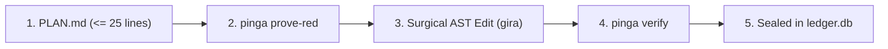

# /pinga — P-Ingá Formal Verification & Contract Harness

P-Ingá (`pinga`) enforces strict formal verification invariants (I1–I20), immutable hash-chained receipts (`ledger.db`), distinct family judge gating (Lei 3 / I13), and token efficiency (Lei 1).

## When to Use

- **ANY code modification:** Before touching code, define a contract in `tasks/T<N>/PLAN.md` and verify with `pinga verify`.
- **Pre-flight RED proofing:** Verify that the test fails on base before implementing the solution (`pinga prove-red`).
- **Ledger integrity audit:** Verify that the ledger chain is intact and uncorrupted (`pinga ledger verify`).
- **Multi-harness health check:** Check integration state across Claude, Pi, OpenCode, Hermes, and TUIOS (`pinga doctor`).
- **Context optimization:** Compact session transcripts preserving system prompts and prefix cache (`pinga compact`).
- **Docsite evaluation:** Score living documentation with LLM-as-a-judge (`pinga docs eval`).

---

## 1. The P-Ingá Contract Lifecycle



### Step 1: Draft `tasks/T<N>/PLAN.md`
Contract files MUST be strictly <= 25 lines total, with valid YAML frontmatter:
```markdown
---
mode: padrao
goal: "Describe the exact task objective in 1-2 lines"
done_when: "bun test tests/feature.test.ts"
touch:
  - src/feature.ts
  - tests/feature.test.ts
---

## Summary
- Context and surgical approach in <= 10 lines.
```
- Allowed modes: `mvp`, `padrao`, `completo`.
- `done_when`: Single shell command that returns exit code 0 when complete.
- `touch`: List of files allowed to be modified (enforced by I5/I14).

### Step 2: Prove RED on Base
Ensure the test or verification command actually fails before the implementation:
```bash
pinga prove-red tasks/T<N>/PLAN.md
```

### Step 3: Implement Changes Surgically
Use AST-guided edits or localized changes. Never overwrite whole files if a surgical replacement works.
```bash
gira outline src/feature.ts
gira read src/feature.ts TargetSymbol
```

### Step 4: Verify Contract and Seal Receipt
Run formal verification against the contract:
```bash
pinga verify tasks/T<N>/PLAN.md
```
When `pinga verify` succeeds, it:
1. Executes `done_when` in a sandbox.
2. Validates execution budget, token count, and touched files.
3. Cryptographically hashes stdout and artifacts.
4. Signs a v1 receipt and appends it to `ledger.db`.

### Step 5: Audit Ledger Integrity
Verify the cryptographic chain of all historical receipts:
```bash
pinga ledger verify
```

---

## 2. Maestro & Multi-Agent Commands

- **Recommend Plan Tier:**
  ```bash
  pinga maestro recommend tasks/T<N>/PLAN.md
  ```
- **Inspect Worker Scoreboard (FTPR & Efficiency):**
  ```bash
  pinga maestro scoreboard
  ```
- **Send Discord Observability Digest:**
  ```bash
  pinga maestro digest --send
  ```
- **Diagnose Multi-Harness Integration:**
  ```bash
  pinga doctor
  ```
- **List Provisional TDD Tests:**
  ```bash
  pinga tdd list
  ```
- **Compact Context Transcript:**
  ```bash
  pinga compact session.json --max-chars 60000 --out compact.json
  ```
