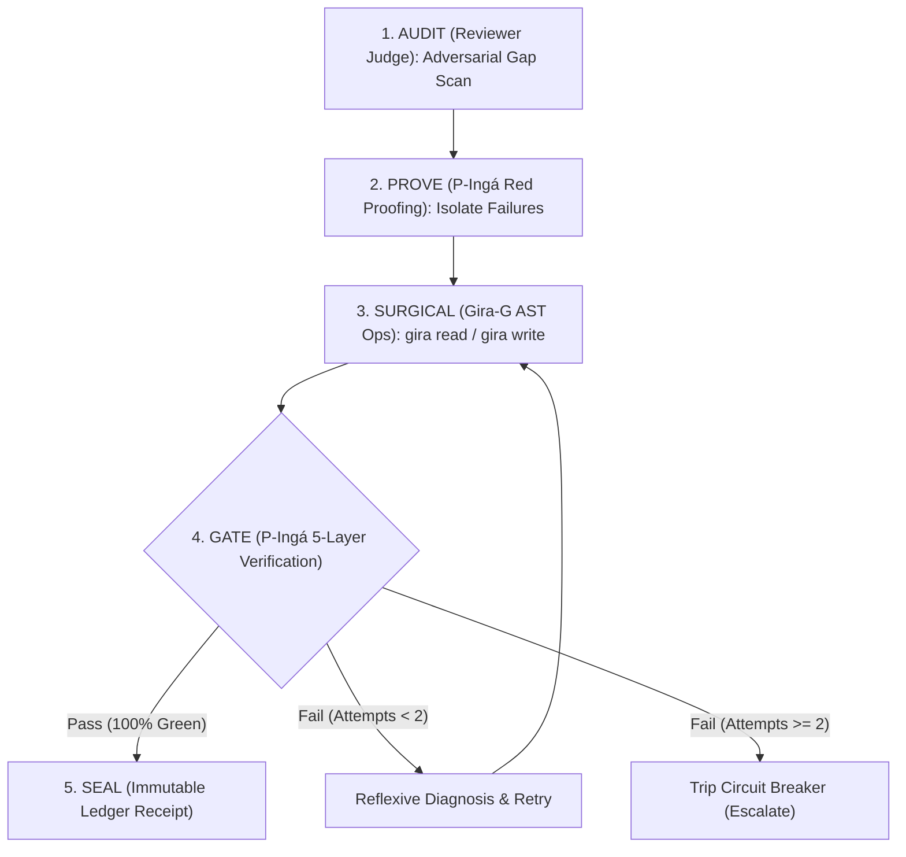

# /red-audit — Adversarial Audit & Closed-Loop Repair

Autonomous red-team inspection harness for verifying contract integrity, closing runtime loopholes, eliminating type unsoundness, and executing surgical AST repairs.



---

## 5 Invariants do Ciclo Red-Audit

1. **Julgamento por Família Distinta (Invariante I13 / Lei 3):**
   O modelo que audita/julga o código nunca deve ser da mesma família do modelo que implementou a solução. Se o executor for DeepSeek/Qwen, o auditor deve ser Gemini/Claude, e vice-versa.
2. **Imunidade de Testes Oficiais (Invariante I5):**
   Testes oficiais em `tests/` são imutáveis e congelados durante a resolução de gaps. Apenas testes provisórios (`tests/scratch_*.ts` ou `.scratch.*`) podem ser criados para TDD preliminar.
3. **Mutações Cirúrgicas AST (Gira-G):**
   Nunca reescrever arquivos inteiros (`write_file` > 100 linhas). As mutações devem ser direcionadas a símbolos específicos via `gira write <file> <symbol> --body '...'` ou `gira add`.
4. **Preservação de Estabilidade de Prefixos (KV Cache):**
   Observações de ferramentas devem ser limitadas no momento da ingestão. Mensagens anteriores no histórico são imutáveis para garantir 90%+ de prompt cache hit.
5. **Recibos Criptográficos no Ledger (Invariante I2):**
   Toda rodada de auditoria concluída deve anexar um recibo canônico SHA256 no banco imutável (`ledger.db`), garantindo histórico auditável contra regressões.

---

## Procedimento de Execução

### Fase 1: Auditoria Adversarial (Reviewer Judge)
Lance um subagente auditor adversarial configurado para encontrar:
- **Type Unsoundness:** Transpilações cegas que omitem checagem estrita (`tsc --noEmit`).
- **Lexer/Parser Edge Cases:** Contagem de chaves em comentários (`// {`), strings, regexes ou template literals.
- **KV Cache Thrashing:** Mutações retroativas no histórico que invalidam prefill.
- **Fail-open Loopholes:** Caminhos com `./` ou barras invertidas burlam listas de arquivos congelados.

### Fase 2: Diagnóstico e Isolamento RED
- Para cada GAP confirmado, crie um caso de teste reproduzível na suíte provisória:
  ```bash
  bun test tests/hooks.test.ts
  go test -v ./internal/manipulator -run TestBraceCountingInComments
  ```

### Fase 3: Mutação Cirúrgica com Gira-G
- Localize o símbolo exato:
  ```bash
  gira outline <file>
  gira read <file> <symbol>
  ```
- Aplique o conserto cirúrgico sem reescrever o arquivo:
  ```bash
  gira write <file> <symbol> --body '<nova implementação segura>'
  ```

### Fase 4: Portão de Verificação (Verification Gate)
- Execute a suíte de testes de ponta a ponta:
  - No Go: `go test ./...`
  - No TypeScript: `bun test`
- Garanta **zero regressões** na suíte prévia.

### Fase 5: Selagem no Ledger
- Registre o recibo da auditoria no ledger do P-Ingá:
  ```bash
  bun bin/pinga.ts ledger verify
  ```
