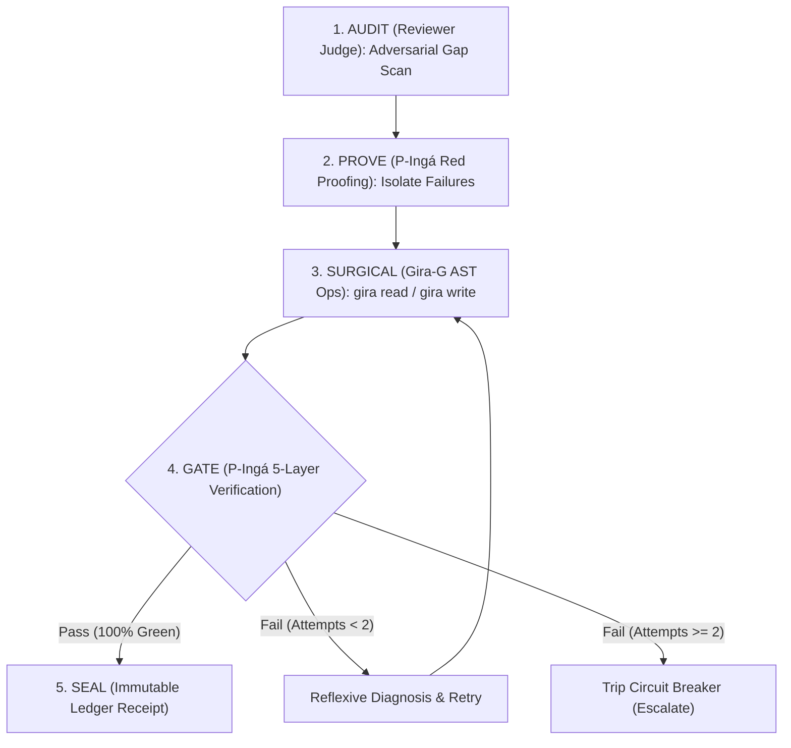

# /red-audit — Adversarial Audit & Closed-Loop Repair

Autonomous red-team inspection harness for verifying contract integrity, closing runtime loopholes, eliminating type unsoundness, and executing surgical AST repairs.



---

## 5 Invariants of the Red-Audit Cycle

1. **Distinct Family Judging (Invariant I13 / Lei 3):**
   The model that audits/judges code must never belong to the same family as the authoring model. If executor is DeepSeek/Qwen, auditor must be Gemini/Claude, and vice-versa.
2. **Official Test Suite Immunity (Invariant I5):**
   Official tests in `tests/` are frozen during gap diagnosis. Only provisional scratch tests (`tests/scratch_*.ts`) may be authored during preliminary TDD.
3. **Surgical AST Mutations (Gira-G):**
   Never rewrite entire files (> 100 lines). Targeted modifications must use `gira write <file> <symbol> --body '...'` or localized edits.
4. **Prefix Cache Stability (KV Cache / Lei 1):**
   Tool outputs must be capped at ingestion time. Prior conversation history is immutable to preserve 90%+ prompt cache hit rates.
5. **Cryptographic Ledger Receipts (Invariant I2 / Lei 2):**
   Every completed audit round must append a canonical SHA256 receipt to `ledger.db` via `pinga verify` or `pinga ledger verify`.

---

## Execution Guide

### Phase 1: Adversarial Audit (Reviewer Judge)
Inspect codebase for:
- **Type Unsoundness:** Unchecked transpilation or missing strict checks (`tsc --noEmit`).
- **Lexer/Parser Edge Cases:** Token boundaries, brace counts in strings/comments, edge regexes.
- **Fail-open Loopholes:** Relative paths `./` or path traversal bypassing frozen file sets.
- **KV Cache Invalidation:** Retroactive edits corrupting prefill cache.

### Phase 2: Diagnostic Isolation & RED Proofing
For each confirmed gap, isolate a reproducible test:
```bash
bun test tests/hooks.test.ts
```

### Phase 3: Surgical Mutation with Gira-G
Locate and edit only the affected AST node:
```bash
gira outline <file>
gira read <file> <symbol>
gira write <file> <symbol> --body '<safe implementation>'
```

### Phase 4: Verification Gate
Run full verification suite with zero regressions:
```bash
bun test
pinga verify tasks/T<N>/PLAN.md
```

### Phase 5: Ledger Sealing
Verify ledger integrity:
```bash
pinga ledger verify
```
