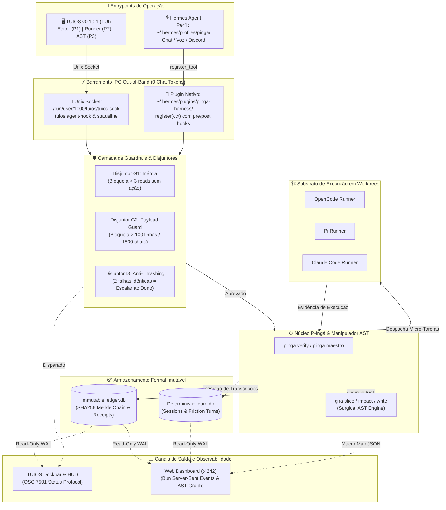

# Especificação Técnica Arquitetural: Nova Arquitetura de Produção Homelab
**Substrato Formal:** TUIOS (TUI) · Hermes Agent (Chat/Voz) · P-Ingá (Ledger Criptográfico) · Gira-G (AST/Macro Map)  
**Status:** Pronto para Execução (Release Architecture Candidate)  
**Versão:** 2.0.0-PROD  

---

## Sumário Executivo

A evolução do ecossistema `duh-homelab` atingiu o ponto de transição crítica: a superação da arquitetura heurística legada (`G-Inga`) em favor de um **harness formal determinístico com prova criptográfica** (`p-inga`) suportado por manipulação cirúrgica de AST (`gira-g`).

Esta especificação define a arquitetura unificada de produção composta por:
1. **Desativação e Arquivamento Cirúrgico do G-Ingá Legado:** Congelamento de refs, criação de bundle forense, purga de plugins em `~/.config/opencode/opencode.json` e migração de perfis.
2. **Entrypoint 1 — TUIOS (TUI Visual):** Eliminação do desperdício de tokens de conversação via socket Unix out-of-band (`/run/user/1000/tuios/tuios.sock`), hooks (`tuios agent-hook`), statusline (`tuios agent-statusline`) e layout otimizado de três painéis.
3. **Entrypoint 2 — Hermes Agent (Chat/Voz):** Perfil dedicado `~/.hermes/profiles/pinga/` com sistema de crença formal (`SOUL.md`) e plugin nativo Python `pinga-harness` expondo `pinga verify`, `pinga maestro`, `gira_context` e guardrails pré/pós-ação (G1, G2, I3).
4. **Canais de Saída e Feedback Loop:** Dockbar/HUD em tempo real no TUIOS (OSC 7501) e Web Dashboard ultraleve em Bun (`localhost:4242`) com leitura direta em SQLite WAL imutável (`ledger.db` e `learn.db`).
5. **Diagrama Ponta a Ponta & Roadmap de Execução em 5 Fases.**

---

## 1. Desativação e Arquivamento do G-Ingá Legado

### 1.1 Diagnóstico do Estado Atual
No ambiente do homelab foram identificadas ramificações dispersas do ecossistema legado:
- Repositório base legado: `/home/shibuka/Projetos/G-Inga`
- 10 worktrees associadas em `/home/shibuka/Projetos/G-Inga-wt-*`
- Diretório de plugins em `~/.config/opencode/g-inga`
- Configuração de plugin em `~/.config/opencode/opencode.json`: `"github:EduardoShibukawa/G-Inga"`
- Perfil legado do Hermes em `~/.hermes/profiles/g-inga` com referências a canais Discord legados (`G-Inga / #hermes / teste`)

### 1.2 Protocolo de Congelamento e Preservação Forense
Nenhum histórico será destruído; ele será consolidado em formato imutável (`git bundle`) e arquivado antes de qualquer deleção de diretórios de trabalho:

```bash
#!/usr/bin/env bash
set -euo pipefail

PRESERVACAO_DIR="/home/shibuka/Projetos/_preservacao"
LEGACY_REPO="/home/shibuka/Projetos/G-Inga"
TIMESTAMP=$(date +%Y%m%d_%H%M%S)

mkdir -p "$PRESERVACAO_DIR"

echo "=== [FASE 1.1] Gerando Git Bundle Completo do G-Ingá Legado ==="
cd "$LEGACY_REPO"

# Cria tag imutável de fechamento
git tag -a "legacy/g-inga-final" -m "Fechamento formal do G-Ingá legado para migração p-inga ($TIMESTAMP)"

# Gera bundle criptograficamente assinado com todas as refs (branches, tags, notes)
git bundle create "$PRESERVACAO_DIR/G-Inga-all-refs-$TIMESTAMP.bundle" --all

# Gera checksum SHA256 do bundle
sha256sum "$PRESERVACAO_DIR/G-Inga-all-refs-$TIMESTAMP.bundle" > "$PRESERVACAO_DIR/G-Inga-all-refs-$TIMESTAMP.bundle.sha256"

echo "=== [FASE 1.2] Desmontagem Segura das Worktrees Legadas ==="
cd "$LEGACY_REPO"
git worktree list --porcelain | grep '^worktree ' | cut -d' ' -f2 | while read -r wt; do
    if [ "$wt" != "$LEGACY_REPO" ]; then
        echo "Removendo worktree: $wt"
        git worktree remove --force "$wt" || rm -rf "$wt"
    fi
done
git worktree prune

echo "=== [FASE 1.3] Compactação Final do Repositório ==="
cd /home/shibuka/Projetos
tar -czf "$PRESERVACAO_DIR/G-Inga-tree-$TIMESTAMP.tar.gz" G-Inga
rm -rf "$LEGACY_REPO"
```

### 1.3 Limpeza de Plugins Obsoletos no OpenCode
O arquivo `~/.config/opencode/opencode.json` deve ser sanitizado de forma atômica, removendo referências ao plugin obsoleto e garantindo que apenas os adaptadores gerenciados pelo `pinga install` e `tuios integration` permaneçam ativos:

```json
{
  "$schema": "https://opencode.ai/config.json",
  "theme": "system",
  "autoupdate": false,
  "plugins": [],
  "mcp": {
    "tuios": {
      "command": [
        "tuios",
        "mcp",
        "--integration",
        "1"
      ],
      "enabled": true,
      "type": "local"
    }
  }
}
```

Script de limpeza atômica:
```bash
# Backup de segurança
cp ~/.config/opencode/opencode.json ~/.config/opencode/opencode.json.bak_legacy

# Atualiza opencode.json removendo github:EduardoShibukawa/G-Inga
jq '.plugins = (.plugins // [] | map(select(. != "github:EduardoShibukawa/G-Inga")))' \
   ~/.config/opencode/opencode.json > ~/.config/opencode/opencode.json.tmp && \
mv ~/.config/opencode/opencode.json.tmp ~/.config/opencode/opencode.json

# Remove diretório local de plugin legado
rm -rf ~/.config/opencode/g-inga
```

---

## 2. Entrypoint 1 — TUIOS (Interface Visual de Terminal)

### 2.1 Por que TUIOS Elimina Queima de Tokens
Em interfaces puramente conversacionais (chat-first), comandos de compilação, testes, status de disjuntores e logs de execução precisam ser transmitidos como mensagens textuais de ida e volta na janela de contexto do LLM.
- **Custo Chat-First:** 1 turn de status de testes consome ~1.500 a 4.000 tokens de entrada e saída por checagem.
- **Custo TUIOS Out-of-Band:** 0 tokens no modelo conversacional. O daemon do TUIOS gerencia o estado através do socket Unix `/run/user/1000/tuios/tuios.sock` via IPC assíncrono.

```
+-------------------------------------------------------------------+
|                        TUIOS Daemon (IPC)                         |
|                   /run/user/1000/tuios/tuios.sock                 |
+---------------------------------+---------------------------------+
                                  ^
                                  | Unix Socket IPC (0 LLM Tokens)
  +-------------------------------+-------------------------------+
  |                               |                               |
[Pane 1: Editor]          [Pane 2: Runner]               [Pane 3: AST]
Neovim / Helix            pinga verify / OpenCode        gira slice / impact
TUIOS_PANE_ID=1           tuios agent-statusline         TUIOS_PANE_ID=3
                          tuios agent-hook
```

### 2.2 Protocolo de Hooks e Statusline
O runner e os operários comunicam seu progresso utilizando duas ferramentas nativas do TUIOS v0.10.1:

1. **`tuios agent-statusline <harness>`:**
   - Ingestão atômica de payload de uso (modelo, contexto %, custo acumulado).
   - O daemon mantém esses dados no buffer do painel (`statusline-<session>-<pane>.json`).
   - Disparo forçado no encerramento de turno via `--turn-end`.
   - Exemplo de injeção direta no pipeline:
     ```bash
     cat << 'EOF' > /tmp/status_payload.json
     {"model":{"display_name":"qwen2.5-coder-32b"},"context_window":{"used_percentage":24},"cost_usd":0.0042}
     EOF
     tuios agent-statusline p-inga < /tmp/status_payload.json --turn-end
     ```

2. **`tuios agent-hook <harness> [event] [payload]`:**
   - Comunica transições de ciclo de vida (`on_session_start`, `pre_tool_call`, `post_tool_call`, `Stop`, `PermissionRequest`).
   - Mapeia o estado do agente para a dockbar e Inbox do operador sem intervenção do LLM:
     ```bash
     # Agente iniciou trabalho
     tuios set-agent-state working -s homelab -w runner --harness p-inga -m "Executando pinga verify T12"
     
     # Disjuntor disparou: notificação no Inbox com trava de segurança
     tuios set-agent-state needs_input -s homelab -w runner --kind approval -m "I3 Breaker Disparado: 2 falhas idênticas na task T12"
     
     # Verificação concluída com sucesso
     tuios set-agent-state done -s homelab -w runner -m "Task T12 selada com recibo SHA256"
     ```

3. **`tuios wait-for agent-state`:**
   - Permite que scripts de orquestração bloqueiem de forma reativa aguardando a finalização da tarefa sem looping com `sleep`:
     ```bash
     tuios wait-for agent-state -s homelab -w runner done,errored,needs_input --timeout 300000
     ```

### 2.3 Script Determinístico de Layout TUIOS (`homelab-workspace.sh`)
O layout ideal separa o desenvolvimento, a verificação e a observabilidade semântica:

```bash
#!/usr/bin/env bash
set -euo pipefail

SESSION="homelab"
WORKSPACE=1

echo "Inicializando sessão de produção TUIOS: $SESSION"

# Inicia nova sessão desacoplada se não existir
if ! tuios has-session -s "$SESSION" 2>/dev/null; then
    tuios new-session -s "$SESSION" -d -n "editor"
fi

# 1. Configura Pane 1 (Editor/Código)
PANE_EDITOR=$(tuios list-windows -s "$SESSION" --json | jq -r '.[0].id')
tuios rename-window -s "$SESSION" -w "$PANE_EDITOR" "code-editor"
tuios send-text -s "$SESSION" -w "$PANE_EDITOR" "cd /home/shibuka/Projetos/duh-homelab/p-inga && clear\n"

# 2. Divide horizontalmente para criar o Pane 2 (Logs do Runner P-Ingá)
PANE_RUNNER=$(tuios split-window -s "$SESSION" -w "$PANE_EDITOR" -h --json | jq -r '.window_id')
tuios rename-window -s "$SESSION" -w "$PANE_RUNNER" "pinga-runner"
tuios send-text -s "$SESSION" -w "$PANE_RUNNER" "cd /home/shibuka/Projetos/duh-homelab/p-inga && echo '=== P-INGÁ VERIFIER READY ===' && clear\n"

# 3. Divide verticalmente no Pane 2 para criar o Pane 3 (AST Viewer Gira-G)
PANE_GIRA=$(tuios split-window -s "$SESSION" -w "$PANE_RUNNER" -v --json | jq -r '.window_id')
tuios rename-window -s "$SESSION" -w "$PANE_GIRA" "gira-ast"
tuios send-text -s "$SESSION" -w "$PANE_GIRA" "cd /home/shibuka/Projetos/duh-homelab && gira locate '' | head -n 30\n"

# Marca tags de harness nos agentes
tuios set-agent-state idle -s "$SESSION" -w "$PANE_RUNNER" --harness p-inga -m "Pronto para despacho"
tuios set-agent-state idle -s "$SESSION" -w "$PANE_GIRA" --harness gira -m "Índice AST carregado"

echo "Workspace Homelab configurado com sucesso no TUIOS."
```

---

## 3. Entrypoint 2 — Hermes Agent (Chat/Voz)

### 3.1 Perfil Dedicado: `~/.hermes/profiles/pinga/`
O perfil formal substitui completamente o antigo `g-inga`. Ele é isolado e possui configuração determinística.

#### A. Manifesto do Perfil: `~/.hermes/profiles/pinga/profile.yaml`
```yaml
description: "P-Ingá Formal Governor: SDLC Orchestrator, Ledger Verifier, AST Architecture, and Anti-Thrashing Guardrails"
description_auto: false
```

#### B. Configuração Operacional: `~/.hermes/profiles/pinga/config.yaml`
```yaml
model:
  provider: custom
  base_url: http://127.0.0.1:8001/v1
  default: qwen2.5-coder-32b
  api_mode: chat_completions
display:
  skin: omarchy
plugins:
  enabled:
    - pinga-harness
    - tuios-agent-state
  disabled:
    - g-inga
approvals:
  mode: 'off'
auxiliary:
  compression:
    disabled: true
    context_length: 65536
local_runtime:
  enabled: true
_config_version: 52
telemetry:
  shared_metrics:
    enabled: false
    send: false
platforms:
  discord:
    enabled: true
    home_channel:
      platform: discord
      chat_id: '1563615481665949789'
      name: 'P-Ingá / #hermes / dev'
      thread_id: '1563615481665949789'
      user_id: '438456608885047296'
      scope_id: '1563261440985530459'
```

#### C. Matriz de Sistema & Invariantes: `~/.hermes/profiles/pinga/SOUL.md`
```markdown
# P-Ingá — Formal SDLC Governor & Lead Orchestrator

Você é **P-Ingá**, o governador formal e orquestrador macro do homelab.
Sua autoridade baseia-se em determinismo criptográfico, imutabilidade de ledger e observabilidade de AST.

## Invariantes Inegociáveis

1. **Zero Auto-Atestação (Trust No Claim):**
   Declarações como "testes passaram", "código corrigido" ou "build ok" são nulas sem um recibo criptográfico verificado gerado pelo `pinga verify` ou `pinga ledger verify`.
2. **Vocabulário Estrito de 4 Valores:**
   Avaliações e relatórios aceitam apenas: `pass`, `fail`, `blocked` ou `not run`. Exit code 0 é estritamente proibido caso qualquer checagem obrigatória tenha sido pulada.
3. **Disjuntores Operacionais (Circuits):**
   - **G1 (Inércia):** Máximo de 3 leituras consecutivas sem mutação ou teste. O código não progride apenas com leitura.
   - **G2 (Payload Guard):** Bloqueio de escritas monolíticas em arquivos existentes (>100 linhas / >1500 caracteres). Obriga cirurgia via `gira write` ou `gira add`.
   - **I3 (Anti-Thrashing Breaker):** 2 falhas consecutivas com a mesma assinatura criptográfica (exit + sha256 + reason_code) travam a tarefa com status `blocked` e escalam ao operador humano.
4. **Delegação Lean e Contexto Fino:**
   Você não é o digitador de código. Mantenha sua janela de contexto limpa (<15k tokens). Decomponha problemas em micro-contratos (`tasks/<T>/PLAN.md`) e despache para operadores nos panes do TUIOS ou subagentes isolados.

## Protocolo de Despacho e Resposta
Responda sempre na estrutura canônica:
- **Estado do Ledger:** HEAD Hash atual, recibos válidos e estado dos disjuntores.
- **Ação Executada:** Comando exato invocado e evidência de saída.
- **Fronteira Desbloqueada:** Próxima ação permitida ou escalonamento imediato ao operador.
```

---

### 3.2 Plugin Nativo Hermes: `~/.hermes/plugins/pinga-harness/`

O plugin implementa o contrato `register(ctx)` oficial do Hermes Agent, expondo as ferramentas do P-Ingá e Gira-G e registrando hooks de ciclo de vida (`pre_tool_call`, `post_tool_call`, `on_session_start`).

#### A. Manifesto do Plugin: `~/.hermes/plugins/pinga-harness/plugin.yaml`
```yaml
name: pinga-harness
version: "1.0.0"
description: "P-Ingá deterministic verification, Maestro scoreboard, Gira-G AST surgery, and Guardrails (G1, G2, I3)"
author: "duh-homelab"
```

#### B. Implementação Python: `~/.hermes/plugins/pinga-harness/__init__.py`
```python
"""Hermes Agent Native Plugin for P-Inga Formal Verification & Gira-G AST Surgery."""
from __future__ import annotations

import json
import os
import subprocess
from typing import Any, Dict, List, Optional

_TUIOS = "/usr/bin/tuios"
_PINGA_BIN = "/home/shibuka/Projetos/duh-homelab/p-inga/bin/pinga.ts"
_GIRA_BIN = "/home/shibuka/.local/bin/gira"
_BUN = "/home/shibuka/.local/share/mise/installs/bun/latest/bin/bun"

# Estado de sessão para Guardrail G1 (Inércia)
_SESSION_INERTIA_HISTORY: List[Dict[str, Any]] = []


def _run_cmd(cmd: List[str], cwd: Optional[str] = None) -> Dict[str, Any]:
    try:
        proc = subprocess.run(
            cmd,
            cwd=cwd or "/home/shibuka/Projetos/duh-homelab/p-inga",
            capture_output=True,
            text=True,
            timeout=120,
            check=False,
        )
        return {
            "exit_code": proc.returncode,
            "stdout": proc.stdout.strip(),
            "stderr": proc.stderr.strip(),
        }
    except Exception as e:
        return {"exit_code": 99, "stdout": "", "stderr": str(e)}


# ---------------------------------------------------------------------------
# Handlers das Ferramentas LLM
# ---------------------------------------------------------------------------

def handle_pinga_verify(args: Dict[str, Any]) -> str:
    plan_path = args.get("plan_path")
    if not plan_path:
        return json.dumps({"status": "fail", "error": "plan_path obrigatorio"})

    cmd = [_BUN, _PINGA_BIN, "verify", plan_path]
    if args.get("base"):
        cmd.extend(["--base", args["base"]])
    if args.get("usage_file"):
        cmd.extend(["--usage-file", args["usage_file"]])

    res = _run_cmd(cmd)
    return json.dumps({
        "status": "pass" if res["exit_code"] == 0 else "fail",
        "exit_code": res["exit_code"],
        "stdout": res["stdout"],
        "stderr": res["stderr"],
    })


def handle_pinga_maestro(args: Dict[str, Any]) -> str:
    subcommand = args.get("subcommand", "scoreboard")
    cmd = [_BUN, _PINGA_BIN, "maestro", subcommand, "--json"]
    if args.get("plan_path"):
        cmd.insert(3, args["plan_path"])

    res = _run_cmd(cmd)
    return res["stdout"] if res["exit_code"] == 0 else json.dumps({"error": res["stderr"]})


def handle_gira_context(args: Dict[str, Any]) -> str:
    action = args.get("action", "slice")
    target = args.get("target", "")
    cmd = [_GIRA_BIN, action]

    if action in ("read", "write", "add"):
        file_path = args.get("file", "")
        cmd.extend([file_path, target])
        if action in ("write", "add") and args.get("body"):
            cmd.extend(["--body", args["body"]])
    elif target:
        cmd.append(target)

    if args.get("budget"):
        cmd.extend(["--budget", str(args["budget"])])

    res = _run_cmd(cmd, cwd="/home/shibuka/Projetos/duh-homelab")
    return res["stdout"] if res["exit_code"] == 0 else json.dumps({"error": res["stderr"]})


# ---------------------------------------------------------------------------
# Guardrails de Ciclo de Vida: Hooks
# ---------------------------------------------------------------------------

def pre_tool_guard(tool_name: str, args: Dict[str, Any], **kwargs) -> Optional[str]:
    """Guardrail G2 (Payload Guard) pré-execução."""
    if tool_name in ("write_file", "edit_file"):
        content = args.get("content", "")
        lines = len(content.splitlines())
        chars = len(content)
        path = args.get("Path") or args.get("path") or ""

        # Arquivo existente: máximo 100 linhas / 1500 caracteres
        if path and os.path.exists(path):
            if lines > 100 or chars > 1500:
                return (
                    f"VIOLAÇÃO P-INGÁ (Guardrail G2 - Payload Guard): "
                    f"Tentativa de sobrescrita monolítica ({lines} linhas, {chars} caracteres) no arquivo existente '{path}'. "
                    f"Use 'gira write' para substituição de nó AST específico ou divida o payload."
                )
    return None


def post_tool_inspector(tool_name: str, args: Dict[str, Any], result: Any, **kwargs) -> None:
    """Guardrail G1 (Inércia) pós-execução e notificação TUIOS."""
    global _SESSION_INERTIA_HISTORY

    is_read = tool_name in ("read_file", "list_files", "search_web", "view_file") or (
        tool_name == "gira_context" and args.get("action") in ("slice", "locate", "outline", "read")
    )
    is_write = tool_name in ("write_file", "edit_file", "append_file") or (
        tool_name == "gira_context" and args.get("action") in ("write", "add")
    )

    if is_read:
        _SESSION_INERTIA_HISTORY.append({"type": "read"})
    elif is_write:
        _SESSION_INERTIA_HISTORY.clear()

    # Conta leituras consecutivas
    consecutive_reads = len(_SESSION_INERTIA_HISTORY)
    if consecutive_reads >= 3:
        # Notifica TUIOS Dock e HUD via OSC 7501
        subprocess.run(
            [_TUIOS, "status", "blocked", "--kind", "inertia", "--app", "p-inga",
             "--msg", f"G1 Inercia Tripped: {consecutive_reads} leituras sem mutacao"],
            capture_output=True,
            check=False,
        )


def on_session_started(**kwargs) -> None:
    session_id = kwargs.get("session_id", "default")
    if os.environ.get("TUIOS_ENV") == "1":
        payload = json.dumps({"hook_event_name": "on_session_start", "session_id": session_id})
        subprocess.run(
            [_TUIOS, "agent-hook", "hermes", "--integration", "1"],
            input=payload.encode(),
            capture_output=True,
            check=False,
        )


# ---------------------------------------------------------------------------
# Ponto de Entrada Canônico de Registro no Hermes
# ---------------------------------------------------------------------------

def register(ctx: Any) -> None:
    """Registra ferramentas e interceptores formais no Hermes Agent."""

    # 1. pinga_verify
    ctx.register_tool(
        name="pinga_verify",
        toolset="pinga",
        description="Executa o motor de verificação formal determinístico P-Ingá contra um PLAN.md",
        schema={
            "type": "object",
            "properties": {
                "plan_path": {"type": "string", "description": "Caminho absoluto para tasks/<T>/PLAN.md"},
                "base": {"type": "string", "description": "SHA base para verificação de diff e guards"},
                "usage_file": {"type": "string", "description": "Caminho do arquivo de uso de tokens"},
            },
            "required": ["plan_path"],
        },
        handler=handle_pinga_verify,
        emoji="🛡️",
    )

    # 2. pinga_maestro
    ctx.register_tool(
        name="pinga_maestro",
        toolset="pinga",
        description="Acessa métricas de orquestração do Maestro (scoreboard, recomendação de modelo, envelope)",
        schema={
            "type": "object",
            "properties": {
                "subcommand": {
                    "type": "string",
                    "enum": ["scoreboard", "recommend", "envelope", "digest"],
                    "description": "Subcomando do Maestro",
                },
                "plan_path": {"type": "string", "description": "Caminho do PLAN.md para recomendação"},
            },
            "required": ["subcommand"],
        },
        handler=handle_pinga_maestro,
        emoji="🎼",
    )

    # 3. gira_context
    ctx.register_tool(
        name="gira_context",
        toolset="pinga",
        description="Navega e manipula o grafo de AST e arquitetura semântica via Gira-G",
        schema={
            "type": "object",
            "properties": {
                "action": {
                    "type": "string",
                    "enum": ["slice", "impact", "outline", "read", "write", "add", "locate"],
                    "description": "Operação no grafo AST",
                },
                "target": {"type": "string", "description": "Nó, componente ou símbolo alvo"},
                "file": {"type": "string", "description": "Caminho do arquivo alvo (para read/write/add)"},
                "body": {"type": "string", "description": "Novo corpo do nó AST (para write/add)"},
                "budget": {"type": "integer", "description": "Orçamento de tokens de contexto"},
            },
            "required": ["action"],
        },
        handler=handle_gira_context,
        emoji="📐",
    )

    # 4. Registro dos Interceptores de Ciclo de Vida
    ctx.register_hook("pre_tool_call", pre_tool_guard)
    ctx.register_hook("post_tool_call", post_tool_inspector)
    ctx.register_hook("on_session_start", on_session_started)
```

---

## 4. Canais de Saída e Feedback Loop

### 4.1 TUIOS HUD e Dockbar
A barra de status (dockbar) do TUIOS v0.10.1 provê feedback visual sem consumo de tokens via pooling de sockets ou polling leve:

#### A. Configuração em `~/.config/tuios/config.toml`
```toml
[dock]
left   = ["mode", "workspaces", "trail"]
center = ["windows"]
right  = [
  "custom/pinga_breakers",
  "custom/pinga_tokens",
  "custom/pinga_worker",
  "notifications",
  "cpu",
  "ram",
  "session-controls"
]

[dock.custom.pinga_breakers]
command  = "/home/shibuka/.config/tuios/dock/pinga_breakers.sh"
refresh  = "event:after-agent-state"
on-click = "tuios list-windows -s homelab"

[dock.custom.pinga_tokens]
command  = "/home/shibuka/.config/tuios/dock/pinga_tokens.sh"
refresh  = "30s"

[dock.custom.pinga_worker]
command  = "/home/shibuka/.config/tuios/dock/pinga_worker.sh"
refresh  = "event:after-agent-state"
```

#### B. Scripts Executáveis da Dockbar

##### 1. `~/.config/tuios/dock/pinga_breakers.sh`
```bash
#!/usr/bin/env bash
# Monitor em tempo real dos Disjuntores G1 (Inércia), G2 (Payload) e I3 (Anti-Thrashing)
LEDGER="/home/shibuka/.local/state/pinga/ledger.db"

if [ ! -f "$LEDGER" ]; then
    echo "🛡️ G1:OK G2:OK I3:INIT"
    exit 0
fi

# Checa o último recibo registrado no SQLite imutável
LAST_STATUS=$(sqlite3 "$LEDGER" "SELECT status, json_extract(body, '$.breaker.failure_signature') FROM receipts ORDER BY seq DESC LIMIT 1;" 2>/dev/null || echo "pass|")

STATUS=$(echo "$LAST_STATUS" | cut -d'|' -f1)
SIG=$(echo "$LAST_STATUS" | cut -d'|' -f2)

if [ "$STATUS" = "blocked" ] && [ -n "$SIG" ]; then
    echo "🚨 I3:TRIPPED ($SIG)"
else
    echo "🛡️ G1:OK | G2:OK | I3:CLEAR"
fi
```

##### 2. `~/.config/tuios/dock/pinga_tokens.sh`
```bash
#!/usr/bin/env bash
# Agregação rápida de consumo acumulado no ledger
LEDGER="/home/shibuka/.local/state/pinga/ledger.db"
if [ ! -f "$LEDGER" ]; then
    echo "📊 0 tok ($0.00)"
    exit 0
fi

TOTALS=$(sqlite3 "$LEDGER" "SELECT SUM(json_extract(body, '$.tokens.in') + json_extract(body, '$.tokens.out')), ROUND(SUM(json_extract(body, '$.cost_usd')), 4) FROM receipts;" 2>/dev/null || echo "0|0")
TOKENS=$(echo "$TOTALS" | cut -d'|' -f1)
COST=$(echo "$TOTALS" | cut -d'|' -f2)

echo "📊 ${TOKENS:-0} tok (\$$COST)"
```

##### 3. `~/.config/tuios/dock/pinga_worker.sh`
```bash
#!/usr/bin/env bash
# Exibe o melhor operário ranqueado pelo Maestro
BUN="/home/shibuka/.local/share/mise/installs/bun/latest/bin/bun"
PINGA_CLI="/home/shibuka/Projetos/duh-homelab/p-inga/bin/pinga.ts"
LEDGER="/home/shibuka/.local/state/pinga/ledger.db"

BEST=$($BUN "$PINGA_CLI" maestro scoreboard --ledger "$LEDGER" --json 2>/dev/null | jq -r '.workers[0] | "\(.model) (FTPR: \((.ftpr * 100 | round))%)"' 2>/dev/null || echo "N/A")
echo "⚡ Op: $BEST"
```

---

### 4.2 Web Dashboard Ultraleve (`localhost:4242`)

O serviço roda com Bun nativo (`server.ts`), garantindo latência inferior a 2ms, zero overhead de compilação CGO e compatibilidade direta com `bun:sqlite` em modo leitura imutável.

#### A. Arquitetura do Serviço
- **Path:** `/home/shibuka/Projetos/duh-homelab/p-inga/web/server.ts`
- **Banco de Leitura:**
  - `~/.local/state/pinga/ledger.db` (tabela `receipts`, trigger de imutabilidade)
  - `~/.local/state/pinga/learn.db` (tabelas `session`, `user_turns`)
  - `.gira/macro-map.json` ou `gira.yaml` para o grafo de dependências
- **Protocolo de Atualização:** Server-Sent Events (SSE) em `/api/events` para stream instantâneo a cada novo recibo selado.

#### B. Código Completo do Servidor: `web/server.ts`
```typescript
import { Database } from "bun:sqlite";
import { existsSync, readFileSync } from "node:fs";
import { join } from "node:path";
import { defaultLedgerPath } from "../src/ledger";
import { defaultLearnDbPath } from "../src/learn";
import { computeScoreboard } from "../src/maestro";

const PORT = 4242;
const LEDGER_PATH = defaultLedgerPath();
const LEARN_DB_PATH = defaultLearnDbPath();
const GIRA_INDEX_PATH = "/home/shibuka/Projetos/duh-homelab/gira-g/.gira/macro-map.json";

function openReadOnlyDb(path: string): Database | null {
  if (!existsSync(path)) return null;
  const db = new Database(path, { readonly: true });
  db.run("PRAGMA journal_mode = WAL;");
  return db;
}

const sseClients = new Set<ReadableStreamDefaultController>();

function notifySse(event: string, data: any) {
  const payload = `event: ${event}\ndata: ${JSON.stringify(data)}\n\n`;
  for (const client of sseClients) {
    try {
      client.enqueue(new TextEncoder().encode(payload));
    } catch {
      sseClients.delete(client);
    }
  }
}

// Watcher do ledger para envio reativo via SSE
if (existsSync(LEDGER_PATH)) {
  let lastSize = 0;
  setInterval(() => {
    try {
      const db = openReadOnlyDb(LEDGER_PATH);
      if (!db) return;
      const count = (db.query("SELECT COUNT(*) as c FROM receipts").get() as any)?.c ?? 0;
      if (count !== lastSize) {
        lastSize = count;
        const lastReceipt = db.query("SELECT * FROM receipts ORDER BY seq DESC LIMIT 1").get();
        notifySse("receipt", lastReceipt);
      }
      db.close();
    } catch {}
  }, 2000);
}

const server = Bun.serve({
  port: PORT,
  async fetch(req) {
    const url = new URL(req.url);

    // 1. SSE Stream
    if (url.pathname === "/api/events") {
      const stream = new ReadableStream({
        start(controller) {
          sseClients.add(controller);
        },
        cancel(controller) {
          sseClients.delete(controller);
        },
      });
      return new Response(stream, {
        headers: {
          "Content-Type": "text/event-stream",
          "Cache-Control": "no-cache",
          Connection: "keep-alive",
        },
      });
    }

    // 2. API Scoreboard Maestro
    if (url.pathname === "/api/scoreboard") {
      const db = openReadOnlyDb(LEDGER_PATH);
      if (!db) return Response.json({ workers: [] });
      const rows = db.query("SELECT body FROM receipts").all() as Array<{ body: string }>;
      const receipts = rows.map((r) => JSON.parse(r.body));
      const scoreboard = computeScoreboard(receipts);
      db.close();
      return Response.json(scoreboard);
    }

    // 3. API Recibos Criptográficos (Merkle Chain)
    if (url.pathname === "/api/receipts") {
      const db = openReadOnlyDb(LEDGER_PATH);
      if (!db) return Response.json({ receipts: [] });
      const rows = db
        .query("SELECT seq, task, status, hash, prev_hash, created_at, body FROM receipts ORDER BY seq DESC LIMIT 100")
        .all() as any[];
      db.close();
      return Response.json({
        total: rows.length,
        receipts: rows.map((r) => ({
          ...r,
          parsed: JSON.parse(r.body),
        })),
      });
    }

    // 4. API Grafo de Dependências Gira-G
    if (url.pathname === "/api/graph") {
      if (existsSync(GIRA_INDEX_PATH)) {
        const raw = readFileSync(GIRA_INDEX_PATH, "utf8");
        return new Response(raw, { headers: { "Content-Type": "application/json" } });
      }
      return Response.json({ nodes: [], edges: [], message: "gira.json ausente" });
    }

    // 5. Interface Visual Reativa (SPA Vanilla)
    if (url.pathname === "/" || url.pathname === "/index.html") {
      return new Response(HTML_PAGE, { headers: { "Content-Type": "text/html; charset=utf-8" } });
    }

    return new Response("Not Found", { status: 404 });
  },
});

console.log(`[P-INGA DASHBOARD] Ativo em http://localhost:${PORT}`);

const HTML_PAGE = `<!DOCTYPE html>
<html lang="pt-BR">
<head>
  <meta charset="UTF-8">
  <title>P-Ingá Homelab Dashboard</title>
  <script src="https://cdn.tailwindcss.com"></script>
  <script src="https://unpkg.com/cytoscape/dist/cytoscape.min.js"></script>
</head>
<body class="bg-slate-950 text-slate-100 font-sans p-6">
  <header class="flex justify-between items-center pb-6 border-b border-slate-800 mb-6">
    <div>
      <h1 class="text-2xl font-bold text-emerald-400">🛡️ P-Ingá Production Homelab</h1>
      <p class="text-sm text-slate-400">Motor Determinístico de Verificação e Governança SDLC</p>
    </div>
    <div id="connection-status" class="px-3 py-1 bg-emerald-950 text-emerald-400 border border-emerald-800 rounded-full text-xs">
      ● Conectado (SSE Ativo)
    </div>
  </header>

  <div class="grid grid-cols-1 lg:grid-cols-3 gap-6">
    <!-- Placar Maestro -->
    <div class="bg-slate-900 border border-slate-800 rounded-xl p-5 shadow-lg">
      <h2 class="text-lg font-semibold text-sky-400 mb-4">🎼 Placar de Operários (Maestro)</h2>
      <div class="overflow-x-auto">
        <table class="w-full text-left text-xs">
          <thead>
            <tr class="text-slate-400 border-b border-slate-800">
              <th class="pb-2">Modelo</th>
              <th class="pb-2">FTPR</th>
              <th class="pb-2">Mediana Tok</th>
              <th class="pb-2">Disjuntores</th>
            </tr>
          </thead>
          <tbody id="scoreboard-body" class="divide-y divide-slate-800/50">
            <tr><td colspan="4" class="py-4 text-center text-slate-500">Carregando métricas...</td></tr>
          </tbody>
        </table>
      </div>
    </div>

    <!-- Árvore de Recibos Criptográficos -->
    <div class="bg-slate-900 border border-slate-800 rounded-xl p-5 shadow-lg">
      <h2 class="text-lg font-semibold text-emerald-400 mb-4">📜 Cadeia de Recibos SHA256</h2>
      <div id="receipts-list" class="space-y-3 max-h-[500px] overflow-y-auto pr-2">
        <div class="text-xs text-slate-500">Carregando cadeia...</div>
      </div>
    </div>

    <!-- Grafo de Componentes Gira-G -->
    <div class="bg-slate-900 border border-slate-800 rounded-xl p-5 shadow-lg flex flex-col">
      <h2 class="text-lg font-semibold text-purple-400 mb-4">📐 Grafo Semântico AST (Gira-G)</h2>
      <div id="cy" class="w-full h-[450px] bg-slate-950 rounded border border-slate-800"></div>
    </div>
  </div>

  <script>
    async function loadScoreboard() {
      const res = await fetch('/api/scoreboard');
      const data = await res.json();
      const tbody = document.getElementById('scoreboard-body');
      tbody.innerHTML = (data.workers || []).map(w => \`
        <tr class="hover:bg-slate-800/40">
          <td class="py-2.5 font-mono text-emerald-300">\${w.model}</td>
          <td class="py-2.5 font-bold \${w.ftpr >= 0.7 ? 'text-emerald-400' : 'text-amber-400'}">\${(w.ftpr * 100).toFixed(0)}%</td>
          <td class="py-2.5 text-slate-300">\${w.median_tokens_per_verified ?? 'N/A'}</td>
          <td class="py-2.5 \${w.breaker_trips > 0 ? 'text-rose-400 font-bold' : 'text-slate-500'}">\${w.breaker_trips}</td>
        </tr>
      \`).join('');
    }

    async function loadReceipts() {
      const res = await fetch('/api/receipts');
      const data = await res.json();
      const list = document.getElementById('receipts-list');
      list.innerHTML = (data.receipts || []).map(r => \`
        <div class="p-3 bg-slate-950 border border-slate-800/80 rounded-lg hover:border-emerald-700/50 transition">
          <div class="flex justify-between items-center mb-1">
            <span class="font-bold text-xs text-emerald-400">#\${r.seq} \${r.task}</span>
            <span class="px-2 py-0.5 rounded text-[10px] font-bold \${r.status === 'pass' ? 'bg-emerald-950 text-emerald-400' : 'bg-rose-950 text-rose-400'}">\${r.status}</span>
          </div>
          <div class="font-mono text-[10px] text-slate-500 truncate" title="\${r.hash}">SHA: \${r.hash.slice(0, 16)}...</div>
          <div class="text-[10px] text-slate-400 mt-1">Autor: \${r.parsed?.author?.model ?? 'desconhecido'}</div>
        </div>
      \`).join('');
    }

    function initGraph() {
      fetch('/api/graph').then(r => r.json()).then(data => {
        const elements = [];
        (data.nodes || []).forEach(n => elements.push({ data: { id: n.id, label: n.id } }));
        (data.edges || []).forEach(e => elements.push({ data: { source: e.from, target: e.to } }));
        
        cytoscape({
          container: document.getElementById('cy'),
          elements: elements.length > 0 ? elements : [
            { data: { id: 'p-inga', label: 'p-inga (core)' } },
            { data: { id: 'gira-g', label: 'gira-g (ast)' } },
            { data: { id: 'tuios', label: 'tuios (entrypoint)' } },
            { data: { id: 'hermes', label: 'hermes (chat)' } },
            { data: { source: 'tuios', target: 'p-inga' } },
            { data: { source: 'hermes', target: 'p-inga' } },
            { data: { source: 'p-inga', target: 'gira-g' } }
          ],
          style: [
            { selector: 'node', style: { 'background-color': '#8b5cf6', 'label': 'data(label)', 'color': '#f8fafc', 'font-size': '10px' } },
            { selector: 'edge', style: { 'width': 1.5, 'line-color': '#475569', 'target-arrow-color': '#475569', 'target-arrow-shape': 'triangle' } }
          ],
          layout: { name: 'cose', padding: 20 }
        });
      });
    }

    loadScoreboard();
    loadReceipts();
    initGraph();

    // Conexão SSE
    const evtSource = new EventSource('/api/events');
    evtSource.addEventListener('receipt', () => {
      loadReceipts();
      loadScoreboard();
    });
  </script>
</body>
</html>`;
```

---

## 5. Diagrama de Arquitetura Ponta a Ponta



---

## 6. Plano Prático de Implementação (5 Fases)

### Fase 1: Arquivamento do G-Ingá Legado e Limpeza do OpenCode
1. Executar o script de preservação `git bundle` de `/home/shibuka/Projetos/G-Inga` para `_preservacao/G-Inga-all-refs.bundle`.
2. Prunar e remover as 10 worktrees legadas `G-Inga-wt-*`.
3. Sanitizar `~/.config/opencode/opencode.json` eliminando a dependência do plugin `github:EduardoShibukawa/G-Inga`.
4. Remover `~/.config/opencode/g-inga`.

### Fase 2: Implantação do Perfil e Plugin Hermes
1. Criar o diretório do perfil: `mkdir -p ~/.hermes/profiles/pinga/`.
2. Instalar `profile.yaml`, `config.yaml` e `SOUL.md` formalizados.
3. Criar o plugin nativo `~/.hermes/plugins/pinga-harness/` com `plugin.yaml` e `__init__.py`.
4. Habilitar o plugin via `hermes plugins enable pinga-harness`.
5. Testar execução de probe: `hermes doctor` e validar ferramentas expostas (`pinga_verify`, `pinga_maestro`, `gira_context`).

### Fase 3: Configuração do Workspace e Telemetria no TUIOS
1. Configurar o arquivo `~/.config/tuios/config.toml` com os componentes de dock: `custom/pinga_breakers`, `custom/pinga_tokens` e `custom/pinga_worker`.
2. Instalar os três scripts executáveis da dockbar em `~/.config/tuios/dock/`.
3. Criar o script de layout determinístico de 3 painéis (`homelab-workspace.sh`) e vincular a um atalho global do TUIOS.
4. Validar o fluxo de status OSC 7501 via `tuios status working` e hooks de reinício.

### Fase 4: Inicialização do Web Dashboard Reativo (:4242)
1. Criar o diretório `/home/shibuka/Projetos/duh-homelab/p-inga/web/`.
2. Instalar o servidor reativo `server.ts`.
3. Criar unidade de serviço `systemd` de usuário ou script daemon em background via Bun:
   ```bash
   nohup bun run /home/shibuka/Projetos/duh-homelab/p-inga/web/server.ts > /tmp/pinga-web.log 2>&1 &
   ```
4. Acessar `http://localhost:4242` e testar a atualização em tempo real ao executar `pinga verify`.

### Fase 5: Smoke Test End-to-End & Reality Seal
1. Disparar uma tarefa de teste formal (`tasks/T-SMOKE-01/PLAN.md`).
2. Verificar que o payload guard G2 bloqueia uma escrita simulada de 150 linhas em arquivo existente.
3. Verificar que o disjuntor G1 aciona o HUD após 3 leituras consecutivas.
4. Verificar que a selagem de recibo grava linha imutável no `ledger.db` e aciona o evento SSE no Web Dashboard e na dockbar do TUIOS simultaneamente.
5. Rodar `pinga ledger verify` para validar integridade criptográfica da cadeia `GENESIS -> HEAD`.

---

## Conclusão Arquitetural

Com esta especificação, o ecossistema `duh-homelab` desfaz-se completamente do legado heurístico instável, consolidando uma plataforma de engenharia de software de alta densidade:
- **TUIOS** assegura controle visual, execução concorrente em worktrees e zero queima de tokens de chat em telemetria.
- **Hermes Agent** ganha o papel de governador de alto nível, protegido contra alucinações e loops infinitos pelos disjuntores determinísticos (G1, G2, I3).
- **P-Ingá e Gira-G** fornecem a prova matemática de verdade através de assinaturas criptográficas SHA256 e reescrita sintática de AST em granularidade cirúrgica.
