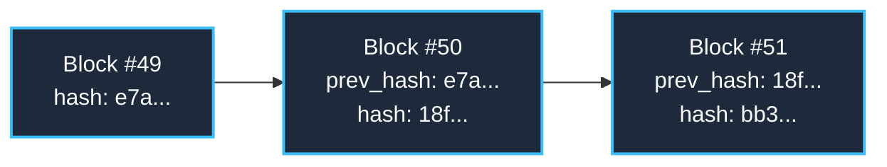

# Hash-Chained Append-Only Ledger

The P-Ingá Ledger (`ledger.db`) is an immutable, append-only SQLite store that cryptographically seals every task verification receipt.

## Cryptographic Structure

Every receipt block contains:
- `seq`: Monotonically increasing sequence integer (`1, 2, 3...`)
- `id`: UUIDv4 receipt identifier
- `task`: Task name (e.g. `T32`)
- `status`: Quad formal status (`pass`, `fail`, `blocked`, `not run`)
- `prev_hash`: SHA-256 digest of the previous canonical JSON block
- `hash`: SHA-256 digest of the current canonical JSON block
- `created_at`: ISO 8601 UTC timestamp



## Anti-Tampering SQL Triggers

The database schema registers hard database triggers that prevent any modifications:

```sql
CREATE TRIGGER IF NOT EXISTS receipts_no_update
BEFORE UPDATE ON receipts
BEGIN
  SELECT RAISE(FAIL, 'ledger is append-only: updates forbidden');
END;

CREATE TRIGGER IF NOT EXISTS receipts_no_delete
BEFORE DELETE ON receipts
BEGIN
  SELECT RAISE(FAIL, 'ledger is append-only: deletes forbidden');
END;
```

If any actor attempts `UPDATE receipts` or `DELETE FROM receipts`, SQLite raises a hard failure and aborts the transaction.

## Verification

To verify the cryptographic chain of custody:

```bash
bun .pinga/pinga-stable ledger verify
```
