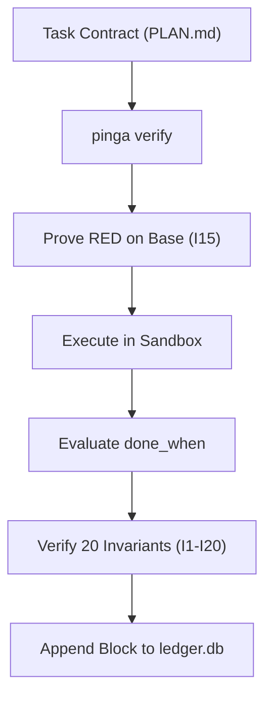

# Introduction to P-Ingá

**P-Ingá** is a formal verification and execution governance harness for autonomous AI coding agents and human engineering teams.

It enforces strict mathematical invariants, append-only hash-chained ledger receipts, multi-harness sandboxing, and adversarial red-team verification to guarantee zero silent drift, 100% contract compliance, and reproducible software delivery.

## Why P-Ingá?

As autonomous coding agents (Claude, Cursor, Pi, Hermes, OpenCode) execute complex refactorings and multi-step tasks, traditional CI is no longer sufficient:
- **Silent Degradation:** Agents pass tests by deleting assertions, skipping edge cases, or mocking away the core domain.
- **Context Drift:** Agent prompts lose task constraints over long multi-turn sessions.
- **Unverified Claims:** Agents claim tasks are "done" without executing real verification commands.

P-Ingá eliminates these failure modes through **Formal Verification Contracts**:
1. **Contract-First Task Plans (`PLAN.md`):** Every task must specify `mode`, `goal`, `done_when`, `touch`, and concrete input/output examples before any code is written.
2. **Immutable Hash-Chained Ledger (`ledger.db`):** Every verification step produces a cryptographically sealed receipt linked to the previous block's SHA-256 hash.
3. **The 3 Laws of Governance:**
   - **Lei 1 (Token Efficiency & FTPR):** Measure token budgets, prevent unbounded context waste, and enforce first-time pass rates.
   - **Lei 2 (Contract Precedence):** The written contract is the sole source of truth. Passing tests outside the contract does not constitute success.
   - **Lei 3 (Circuit Breakers):** Stop infinite retry loops and runaway model hallucination after 3 repeated failures.

## System Architecture

Next: Check out the [Quickstart Guide](./guides/quickstart.html) to run your first verified task in 60 seconds.
